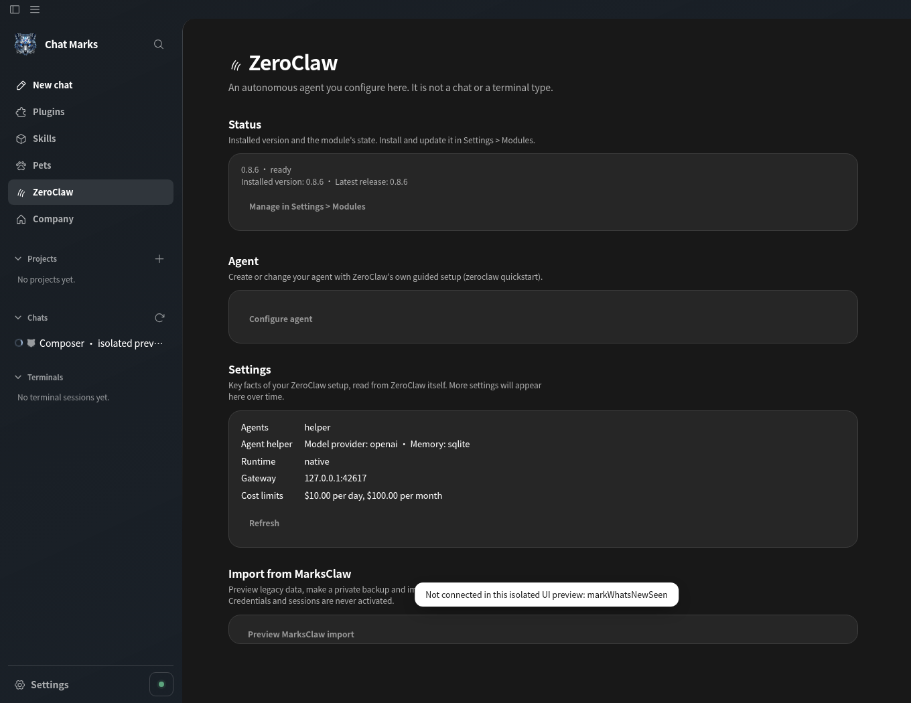
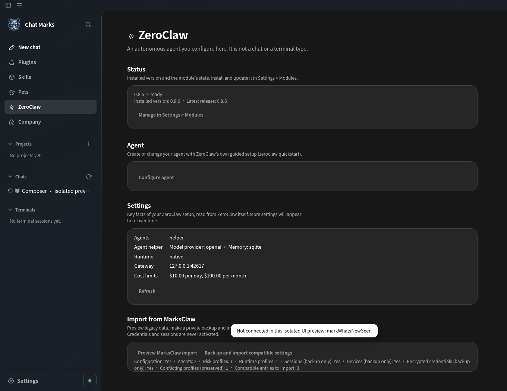

# MarksClaw → ZeroClaw (ZC)

ZeroClaw has a dedicated page beneath Pets. **Preview MarksClaw import** inspects only the legacy `config.toml`, fixed session/device/key presence indicators and the target `config.toml`; the UI receives counts, safe alias names, conflict identifiers and a single-use, five-minute confirmation ticket. Neither CLI nor daemon is launched. The real profile is never changed by this importer.

Upon explicit confirmation, the app copies the **entire** `~/.marksclaw` tree into a new private `~/.zeroclaw.marksclaw-backup-<UTC timestamp>-<random>` directory (mode 0700, files mode 0600), including session databases and credential material **only inside that private backup**, plus the previous ZeroClaw TOML if present. Unsupported file types or symbolic links abort the backup and prevent import. File count, depth and byte limits prevent unbounded copies; a changing configuration or stale ticket aborts before the backup. The backup directory name is shown on success. The user is responsible for keeping the backup private.

Only absent, explicitly allowlisted `risk_profiles`, `runtime_profiles` and `agents` entries from valid TOML are appended. Existing profile entries and target comments/secrets remain untouched; conflicts are skipped. Imports set agents inactive (`enabled=false`) until reviewed. The importer never copies OAuth tokens, `.secret_key` into ZeroClaw, provider credentials, gateway configuration, memory backends, binary paths or sessions. Sessions remain in the private backup; Brain H2 offers an independent, consent-based session-history import flow.

## Fork-only compatibility

- **Marks OAuth:** ZeroClaw 0.8.6 has no confirmed drop-in Marks OAuth refresh/session mechanism. Reauthenticate through a provider ZeroClaw already supports; copying credentials would be unsafe.
- **Marks model provider:** ZeroClaw supports custom OpenAI-compatible endpoints where applicable, but a custom provider needs the user's endpoint, model, authorization and an upstream-supported configuration schema. No fictitious `marks` provider is registered or enabled by this import.
- **Marks memory API:** ZeroClaw 0.8.6 does not expose a verified equivalent for the fork's Marks memory backend. Brain H2 independently supports historical MarksClaw sessions; live memory behavior needs an adapter/plugin verified against its API or a maintained fork.
- **Marks gateway API:** Fork-specific Marks routes are not recreated automatically, since upstream 0.8.6 has no established compatibility route contract.

No binary patch or fork build was performed. Validation uses an exclusively synthetic HOME fixture, never a real `~/.marksclaw` installation.

**Platform boundary:** The importer currently supports native Linux/macOS profiles. On Windows, ZeroClaw runs inside WSL and uses a different HOME; the importer rejects that platform until a WSL-scoped profile/backup operation is implemented. The preview/import operation is not a substitute for ZeroClaw's own configuration review after import.

## Visual evidence

Both screenshots were taken with Electron and synthetic profile data:

