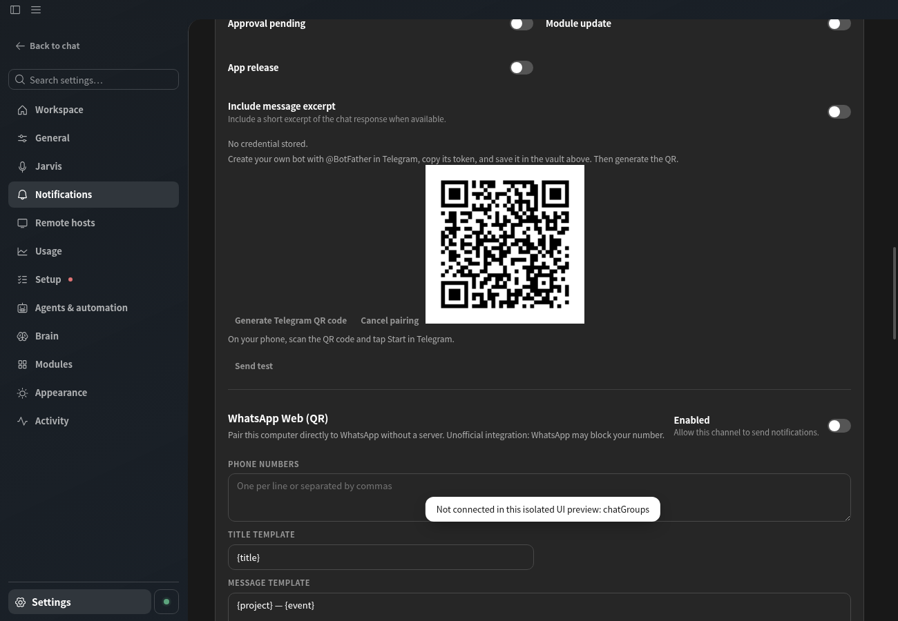
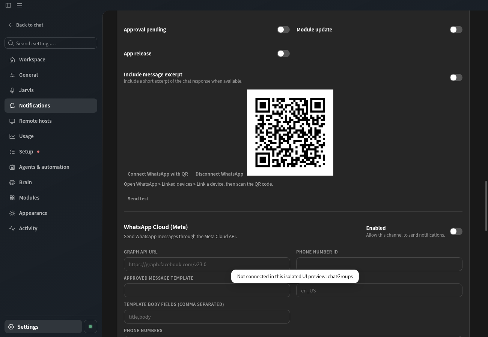

# Telegram e WhatsApp por QR — Central de Notificações

A área **Configurações > Notificações** agora oferece dois fluxos locais de QR code. SMTP, Meta WhatsApp Cloud e Evolution API continuam disponíveis. Nada é enviado automaticamente enquanto o canal/evento estiver desativado.

## Telegram (bot próprio)

1. Abra `@BotFather` no Telegram, crie seu bot com `/newbot` e copie o token.
2. No cartão Telegram, salve o token **uma vez** no cofre do Chat Marks com a senha mestra (o token não volta ao renderer nem entra na exportação de preferências).
3. Clique em **Gerar QR code do Telegram**. O QR contém apenas `https://t.me/<bot>?start=<código aleatório de uso único>`, válido por três minutos. Escaneie no celular e toque **Iniciar** na conversa privada com o bot.
4. O app consulta a Bot API `getUpdates` e aceita apenas uma mensagem privada com o código exato. O `chat_id` é adicionado aos destinos do canal. Ative o canal e os eventos desejados e salve as configurações.

O QR não substitui o token do bot. Importar preferências requer salvar novamente as credenciais no cofre. Bots que usam um webhook exclusivo podem exigir a remoção desse webhook antes de `getUpdates` funcionar; nenhum webhook é alterado pelo Chat Marks.

## WhatsApp Web (local, sem servidor)

1. Clique em **Conectar WhatsApp por QR** no cartão **WhatsApp Web (QR)**.
2. No telefone, abra **WhatsApp > Aparelhos conectados > Conectar um aparelho** e escaneie o QR na tela.
3. Após conectar, informe números no formato internacional (apenas dígitos) e configure quais eventos devem enviar notificações.
4. O botão **Desconectar WhatsApp** encerra a conexão e remove os arquivos de autenticação locais. O app tenta executar o logout remoto; se o telefone estiver offline, revise também os dispositivos vinculados no WhatsApp.

O próprio processo principal Electron executa `@whiskeysockets/baileys@7.0.0-rc14`; nenhum servidor próprio ou credencial de API é necessário. A sessão fica em `<userData>/notifications/whatsapp-web/` (diretório 0700, `creds.json` com permissão 0600 após gravação). O app tenta reconectar automaticamente apenas sessões já registradas. Nenhuma chave é retornada ao renderer, que recebe apenas o QR PNG gerado localmente e um estado simplificado.

**Aviso:** integração não oficial. O WhatsApp pode alterar o protocolo ou bloquear o número. Não há garantia de entrega nem de suporte da Meta. A versão usada de Baileys é uma candidata de lançamento, sujeita a incompatibilidades futuras.

## Evidências sintéticas

As capturas foram feitas no Electron/Chromium com APIs e QR fictícios, sem telefone, conta, cofre ou sessão real. O teste de geração real de PNG usa um link Telegram sintético e confirma a assinatura do PNG. Testes de Telegram usam servidor `fetch` falso; os testes WhatsApp usam socket Baileys falso e diretórios temporários. Verificação com provedores reais continua sendo uma etapa de homologação manual.
