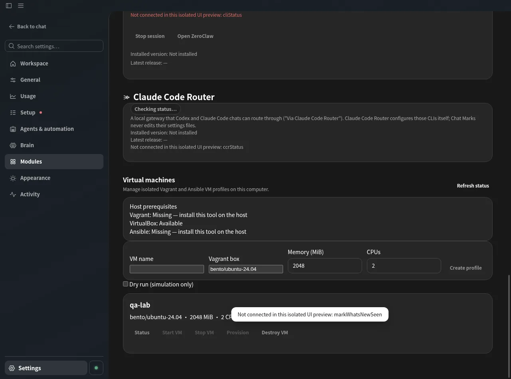
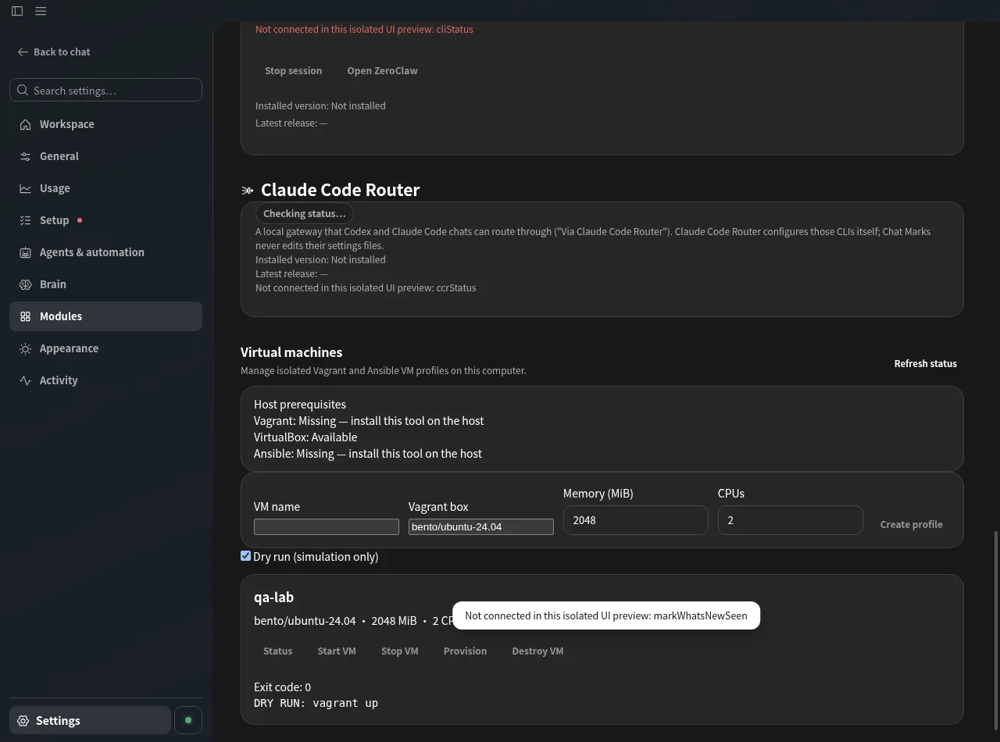

# Item N — isolated Vagrant + Ansible VM labs

The Chat Marks desktop has a **Virtual machines** card under **Settings → Modules**,
listing local profiles, prerequisites, status, live logs and fixed lifecycle
actions (init, status, up, halt, provision, destroy). Destruction requires the
exact profile name; a running action can be cancelled. **Dry run (simulation
only)** shows how an action would run without invoking the hypervisor.
Opening Settings never creates or starts a VM.

The fixed, schema-validated `marksVms:request` IPC surface admits the active
Electron main frame only. It exposes no free-form shell command, executable,
working directory, environment or filesystem root. Labs are stored under
`app.getPath('userData')/vms`, separate from CLI preview profiles. The main
process verifies generated templates, manifest digests, resources, and directory
types before invoking a fixed Vagrant argv without a shell. Per-VM jobs have
bounded logs (160 chunks, 4,096 chars each) and a 15-minute deadline. Job
status is process-local: after a restart, inspect actual VM state before running
another action.

Future integration with **L remote hosts** can resolve opaque remote-host IDs
in main and keep connection credentials in the encrypted Vault/master-key
interface. Do not send remote secrets or raw private keys to this screen.

Usage (from the repository):

~~~sh
node scripts/marks-vms.mjs init sandbox --memory 2048 --cpus 2
node scripts/marks-vms.mjs list
node scripts/marks-vms.mjs doctor
node scripts/marks-vms.mjs up sandbox --dry-run
node scripts/marks-vms.mjs up sandbox
node scripts/marks-vms.mjs status sandbox
node scripts/marks-vms.mjs provision sandbox
node scripts/marks-vms.mjs halt sandbox
node scripts/marks-vms.mjs destroy sandbox --confirm-destroy sandbox
~~~

The default lab directory on Linux is ~/.local/share/chat-marks/vms unless
XDG_DATA_HOME is set. Use --root with an absolute path to choose another location.
Init exclusively creates a new directory containing Vagrantfile, site.yml and
lab.json with SHA-256 hashes for the generated templates. No credentials are
written; VirtualBox does not automatically share the host directory with guests.
Operations reject altered templates and pass fixed arguments without a shell.
Destroy requires confirmation by the exact VM name.

Real VM operations require Vagrant, VirtualBox, the Ubuntu 24.04 Vagrant box,
and host-side Ansible. The read-only doctor checks tool availability using
fixed version arguments without a shell; on 2026-10-22 it detected VirtualBox,
but not Vagrant or Ansible on the Linux host. No VM was started. The generated
playbook only pings the guest. There is no autonomous provisioning or connection
to the vault, remote-host profiles or the production app.

Still necessary before production VM execution: verify host tooling and
the actual hypervisor on Linux, Windows and WSL, and examine cancellations
while Vagrant is creating resources. The current host cannot exercise real
VM operations, so the desktop IPC and Chromium tests use synthetic inputs
and dry-run simulations.
